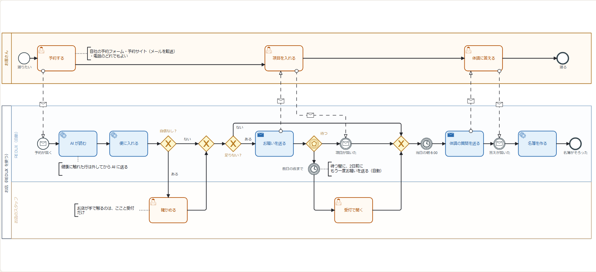

# 書類の自動化の流れ（2026-10-27）

11/9 の中間発表の柱「書類が勝手に名簿になる」の流れ。予約が届いてから、当日の朝に条例の潜水者名簿がそろうまで。

- `doc-automation.bpmn` — BPMN 2.0。https://demo.bpmn.io に落とすと開いて直せる
- `doc-automation.png` — 同じ図の画像

上の枠がお客さん、下の枠がお店（REDUX の自動と、お店のスタッフの 2 つの帯）。点線はお客さんとお店の間のメールと予約。
お店の人が手で触るのは「確かめる」（AI の読み取りに自信が無いとき）と「受付で聞く」（前日の夜までに返事が無いとき）の 2 か所だけ。

まだ作っていない所: お客さんへのメールの自動送信と再送、当日の朝の名簿づくり、予約メールの転送での受け取り（独自のドメインとメール送信の設定が要る）。
